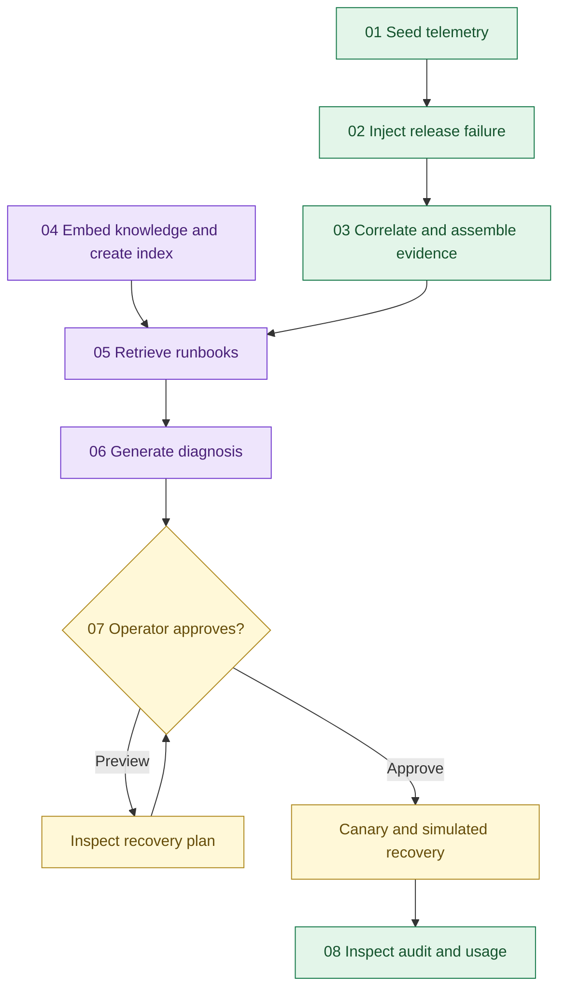

<div align="center">

# ◈ AI Ops · Under the Hood

### The workbench workflow, one Python script at a time.


**Eight workflow steps + one change-stream bonus. No Streamlit required.**

</div>

These examples unpack the supplied AI Operations Workbench. They use the same 24 programs, eight LOBs, `REL-241` recipient-mapping defect, knowledge documents, and collection shapes. The workflow stays visible in individual scripts instead of being hidden behind the UI buttons.

Each numbered script is a separate command-line program. Keep the folder together: they share `config.py`, `common.py`, and `fixtures.py`, and do not import your `app.py`. The scripts use real Atlas reads/writes and real provider calls; they do not provide an offline preview. Adobe/Splunk inputs and remediation are synthetic.

## Start here

```bash
cd AI_Ops_Workflow_Examples
python -m pip install -r requirements.txt
```

Hardcode your configuration in `config.py` once:

```python
ATLAS_URI = "mongodb+srv://<user>:<password>@<cluster>/"
VOYAGE_API_KEY = "<your-voyage-key>"
OPENAI_API_KEY = "<your-openai-key>"
```

No `.env` or environment-variable lookup. The legacy OpenAI SDK is pinned to **0.28.1**, using `openai.ChatCompletion.create()`, as in the supplied app.

The default database is `uhg_aiops_workflow_examples`, so you can demonstrate these scripts independently of your UI scenarios. Use your normal Atlas network access and database credentials; index setup also needs search-index management privileges. Use an Atlas deployment supporting Vector Search and change streams.

The same `--run` value identifies a scenario across separate Python processes. It defaults to `examples-demo-001`. Start another demonstration with a new value, such as `examples-demo-002`; each command in that demonstration must use that value.

## Run the workflow

```bash
python 01_seed_telemetry.py --run examples-demo-001
python 02_inject_incident.py --run examples-demo-001
python 03_correlate_findings.py --run examples-demo-001
python 04_embed_and_index.py --run examples-demo-001
```

Check the index until it reports `Queryable`:

```bash
python 04_embed_and_index.py --status
```

Then retrieve, diagnose, inspect the recovery plan, and approve:

```bash
python 05_retrieve_runbooks.py --run examples-demo-001 --rerank
python 06_diagnose_root_cause.py --run examples-demo-001
python 07_approve_and_recover.py --run examples-demo-001
python 07_approve_and_recover.py --run examples-demo-001 --approve --operator Jeff
python 08_audit_and_usage.py --run examples-demo-001
```

Omit `--rerank` to skip that additional Voyage call. To inspect exactly what the diagnosis will receive without calling OpenAI:

```bash
python 06_diagnose_root_cause.py --run examples-demo-001 --evidence-only
```

Step 08 can run at any stage after seeding. Try it after injection and again after recovery to compare the latest batch health and history.

## What each script teaches

| Script | Workflow focus | What to point out |
| :--- | :--- | :--- |
| `01_seed_telemetry.py` | Document modeling and indexed persistence | 1,440 operational batches; stable IDs; retries preserve existing records |
| `02_inject_incident.py` | Database-side synthetic incident injection | An update pipeline calculates failures and backlog for 90 batches across six programs |
| `03_correlate_findings.py` | Structured correlation and evidence collection | `$match`, `$group`, `$addToSet`, `$sum`, and `$sort` identify the common release/error |
| `04_embed_and_index.py` | Knowledge preparation | Voyage document embeddings, cached unchanged content, 1,024-dimension cosine index |
| `05_retrieve_runbooks.py` | Semantic retrieval | Query embeddings, `$vectorSearch`, model-signature filter, optional Voyage reranking |
| `06_diagnose_root_cause.py` | Evidence-grounded analysis | Explicit prompt plus logs, code diff, payload, and retrieved runbooks |
| `07_approve_and_recover.py` | Human approval and verification | Reproduce the defect, validate the old adapter, and append synthetic healthy batches |
| `08_audit_and_usage.py` | Persisted history and aggregation | Timeline, tokens by provider/model, latest delivery health |
| `09_watch_change_stream.py` | Optional event-driven observation | Receive incident insert/update events directly from MongoDB |

Each script's opening docstring maps it to the corresponding workbench function. The numbered files contain the workflow logic; shared helpers handle connectivity, provider requests, logging, and CLI formatting.

## How the pieces connect



Knowledge/index setup is reusable across scenarios; it need not wait for incident injection. Existing search indexes are inspected instead of recreated. A queryable index may still be catching up with recently written documents: retry retrieval if needed.

## The story to tell while showing code

**01–03: “We can establish the affected scope before using an LLM.”**

The fixtures produce healthy batches. The incident changes the final 15 minutes for six programs. Atlas groups their errors by release and error code. Evidence includes real bundled code text and a synthetic input payload, rather than a model-invented explanation.

**04–05: “Operational history becomes retrievable context.”**

Eight synthetic runbooks and historical incidents are embedded with Voyage. An investigation query is embedded separately using `input_type="query"`. Atlas searches matching model/dimension signatures. Optional reranking refines the returned evidence. Similarity and reranking scores measure relevance, not causal confidence.

**06: “The model explains the evidence we can inspect.”**

The stored evidence is sent to OpenAI. No credentials, embedding vectors, or arbitrary live production documents are included in that evidence bundle. The response is saved with the incident and transitions it to `Awaiting approval`.

**07–08: “Recovery is controlled and reviewable.”**

The recovery script requires an explicit `--approve` flag. It executes only the bundled fixture functions: the new adapter must fail, and the old adapter must map the recipient correctly. It then appends healthy synthetic batches and records the approval label and simulated replay count. It never calls Adobe, a deployment system, or executes code generated by the model. Prior failed batches remain.

## Bonus: show change streams in two terminals

In terminal A, start the watcher before creating a fresh scenario:

```bash
python 09_watch_change_stream.py --run examples-demo-002 --seconds 300
```

In terminal B, run steps 01–07 with `--run examples-demo-002`. Terminal A prints incident events as the workflow updates the shared store.

This adds a capability not present in the supplied app. It demonstrates direct driver access, with no MongoDB MCP server dependency. It observes events only; it does not automatically launch the next step or implement the proposed specialist architecture.

`changed_fields` is the event's update description. `current_state` uses `full_document="updateLookup"` and can reflect a later committed document state if multiple updates happen quickly. The watcher starts from when it opens, stops after its time limit, and does not save resume tokens. A production consumer would need durable checkpointing, idempotent processing, failure recovery, and loop prevention.

## Collections and compatibility

| Collection | Key information |
| :--- | :--- |
| `telemetry` | `run_id`, program, LOB, minute, attempted/failed counts, backlog, release, error |
| `incidents` | `_id` equals scenario ID; state, evidence, retrieved runbooks, analysis, approval metadata |
| `knowledge` | Shared runbooks, embeddings, and model/dimension signature |
| `activity` | Scenario, stage, timestamp, provider, model, token count |

Use the same database as the workbench only when you intentionally want shared records. The UI does not provide a picker for CLI scenarios, so compatible documents will not automatically attach a CLI scenario to the current Streamlit session.

There are two deliberate educational extensions: step 03 correlates in an Atlas aggregation, and step 08 calculates latest health in an aggregation. The original app calculates these summaries in Python. Step 09 is also new. These examples do not add autonomous agents, live Splunk/Adobe connectors, MCP servers, or Temporal.

## Repeatability and limits

- Run steps sequentially for a given scenario. These are walkthrough scripts, not a concurrent production workflow engine.
- Seed retries insert only missing batches. A progressed scenario cannot be reset by seeding; choose a new run ID.
- Incident injection recalculates deterministic fixture values. Recovery batch IDs prevent duplicate batches on retries. Audit events may repeat when a step is rerun; no exactly-once guarantee is claimed.
- Calling retrieval/diagnosis again makes new provider requests and can incur charges. Embedding setup reuses unchanged document embeddings.
- Once a scenario is recovered, step 07 exits without adding another recovery batch. Repeating earlier stages requires a new scenario.
- If you rerun step 03, it replaces assembled evidence; rerun retrieval before diagnosis. Existing state prerequisites are checked by each script.
- Token summaries cover recorded provider responses. They do not calculate dollar cost or include unreported usage from failed requests.
- The `--operator` value is a demo label, not authenticated approval or a tamper-proof audit identity.
- All retained history remains until explicitly cleaned up; these scripts do not delete runs or install a TTL policy.

Keep credential values out of committed files. The shipped `config.py` contains empty credential strings.

## Files to add to your repo

Copy this folder alongside your existing app and top-level README. Keep your app as the presentation layer and use these scripts when someone asks, “Show me what is actually happening under the hood.”

API references: [PyMongo indexes](https://www.mongodb.com/docs/languages/python/pymongo-driver/current/indexes/), [Voyage embeddings](https://docs.voyageai.com/docs/embeddings), [PyMongo change streams](https://www.mongodb.com/docs/languages/python/pymongo-driver/current/monitoring-and-logging/change-streams/).
