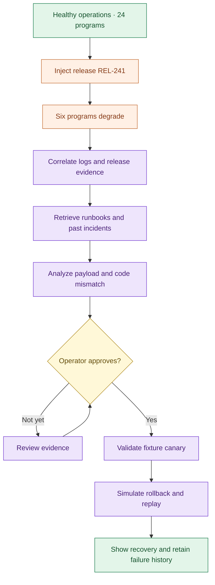
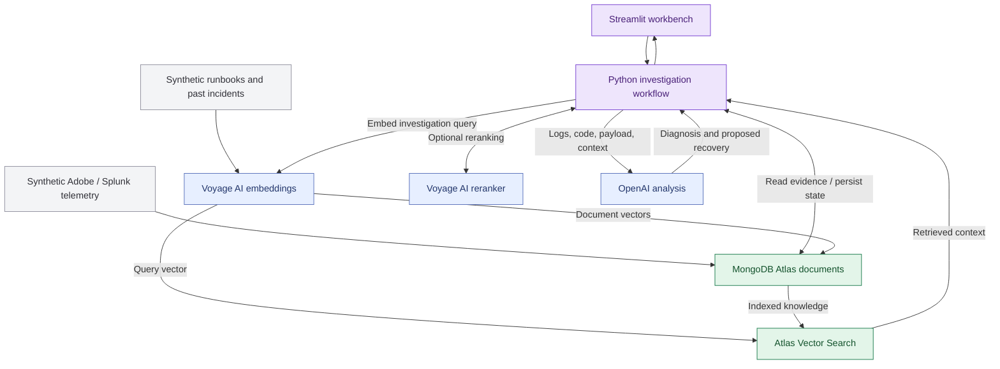
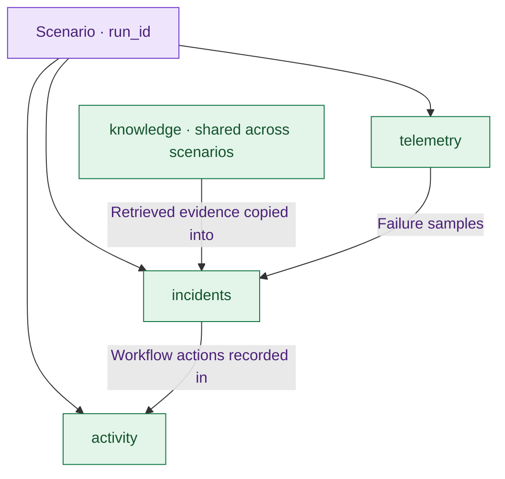

<div align="center">

# ◈ AI Operations Workbench

### From signal to resolution.

Incident investigation demo 


**24 programs · 8 lines of business · One shared incident**

[The story](#the-story) · [Quick start](#quick-start) · [Customer walkthrough](#customer-walkthrough) · [Architecture](#architecture) · [Next chapters](#next-chapters)

</div>

---

## The story

A release ships. Communication failures spike across six programs. Reporting queues grow. Operations has several alerts, scattered logs, and one question:

> **What changed, who is affected, and how do we recover?**

The workbench brings operational signals, source-code evidence, historical incidents, and runbooks into one investigation. MongoDB Atlas holds the operational context. Voyage AI powers semantic retrieval. OpenAI analyzes the evidence. An operator approves a simulated recovery, and the workflow records its actions.

The demo follows a concrete defect: a shared Adobe adapter changes its expected recipient field from `contact.email` to `contact.emailAddress`, while upstream producers continue sending the original field.

**The payoff:** customers can inspect the logs, the code change, the payload, and the retrieved knowledge behind the diagnosis.

> [!NOTE]
> This is a demonstration built around the Optum Digital / EDET use case. All program names, Adobe/Splunk telemetry, source fixtures, runbooks, and historical incidents are synthetic. It is not a production UHG deployment or an official integration.

## Meet the workbench

| Surface | What happens | Why it matters |
| :--- | :--- | :--- |
| 🟢 **Operations overview** | Track program health, delivery success, latency, and reporting backlog | Establish the affected scope before investigating |
| 🟣 **Incident workbench** | Correlate failures, retrieve context, and produce an evidence-backed diagnosis | Turn separate signals into a reviewable investigation |
| 🔎 **Knowledge & code** | Inspect the release diff, sample payload, and retrieved operational memory | Make the diagnosis explainable |
| ✅ **Recovery controls** | Approve a simulated rollback and replay, with a fixture canary check | Keep a person in control of the recovery step |
| 📋 **Agent activity** | Review workflow events and provider-reported token usage | See what ran and what it consumed |

The interface uses a light gray canvas, purple controls, green health indicators, thin borders, and a subtle dotted header. It is designed for a live customer conversation, with the evidence one tab away.

## The incident journey



## Quick start

### 1. Install the dependencies

Use Python 3.10 or newer. The application uses the legacy OpenAI Python interface.

```bash
python -m pip install streamlit pymongo requests pandas openai==0.28.1
```

### 2. Add your demo credentials

Edit the configuration section at the top of `uhg_aiops_demo.py`:

```python
ATLAS_URI = "mongodb+srv://<username>:<password>@<cluster>/"
VOYAGE_API_KEY = "<your-voyage-key>"
OPENAI_API_KEY = "<your-openai-key>"
```

Credentials are hardcoded directly in the script. No `.env` file is required.

> [!IMPORTANT]
> Keep the repository copy's credential fields blank. Add keys only to your local working copy, and check your diff before committing.

### 3. Launch

```bash
python -m streamlit run uhg_aiops_demo.py
```

The app opens in **Offline preview**, so you can explore the interface without credentials. Select **Atlas connected** for real persistence, embeddings, vector retrieval, and AI investigation.

### 4. Prepare connected mode

Your Atlas deployment needs network access from your laptop, a database user that can read and write the demo database, and permissions to create the vector search index. Search-index management permissions are needed for setup.

Use the sidebar in this order:

| Step | Action | Result |
| :--- | :--- | :--- |
| 1 | **Initialize Atlas** | Writes 1,440 synthetic telemetry batches for the current scenario |
| 2 | **Build knowledge embeddings** | Embeds new or changed knowledge documents with Voyage and stores them in Atlas |
| 3 | **Create vector index** | Creates the named vector index only if it does not already exist |
| 4 | **Refresh index status** | Wait until the index reports `Queryable` |
| 5 | **Inject release incident** | Starts the customer demonstration |

Index setup is explicit. The app does not recreate the index on every rerender. Knowledge documents are reused across scenarios. Search indexing is asynchronous; if retrieval is initially empty, allow indexing to finish and retry.

### Demo configuration

| Setting | Current value |
| :--- | :--- |
| Database | `uhg_aiops_demo` |
| Embedding model | `voyage-3.5` |
| Embedding dimensions | `1024` |
| Similarity | Cosine |
| Vector index | `aiops_voyage35_1024` |
| Optional reranking model | `rerank-2.5` |
| Investigation model | `gpt-4.1-mini` |
| OpenAI SDK interface | `openai.ChatCompletion.create()` with `openai==0.28.1` |

If you change the embedding model or dimensions, rebuild the knowledge embeddings and use an appropriately configured new index. Document and query embeddings must use matching settings. Available models depend on your provider account.

## Customer walkthrough

**Five minutes. Left to right through the tabs, with one return to approve recovery.**

### ① Operations overview: establish the baseline

> “Here are 24 programs across eight lines of business. We can see communication health and downstream backlog together.”

Point out the healthy program cards and current delivery success. Metrics represent the latest batch, while the chart shows the scenario history.

Click **Inject release incident**.

> “A shared adapter release has caused six programs to degrade. These failures may have one common cause.”

Show the drop in delivery success and the growing backlog.

### ② Incident workbench: investigate

Click **Run investigation**.

> “We bring together the failures, their release identifier, a code change, and a sample payload. Then we retrieve relevant runbooks and historical incidents from Atlas.”

In connected mode, Voyage embeds the investigation query, Atlas Vector Search retrieves operational knowledge, and OpenAI analyzes the assembled evidence. Optional Voyage reranking reorders the retrieved results.

### ③ Knowledge & code: make the evidence visible

> “The new adapter expects `contact.emailAddress`. The incoming payload still sends `contact.email`. We can inspect that mismatch directly.”

Show the code diff, the payload, and retrieved evidence such as `RB-101` and `INC-204`. The exact retrieval order and model wording can vary.

Retrieval scores describe relevance. They are not confidence percentages for the diagnosis.

### ④ Incident workbench: approve recovery

Select the approval checkbox and click **Execute simulated recovery**.

> “The operator approves the recovery. We validate the previous adapter against the fixture payload, then simulate rollback and replay.”

Return to **Operations overview** to show the recovered state. The recovery adds a healthy batch; original failure history remains available.

### ⑤ Agent activity: close with accountability

> “We retain the workflow events and provider-reported token usage, so we can review what happened during this investigation.”

Show the retrieval events, diagnosis, operator-approved recovery event, and provider token totals. These are usage records, not dollar-cost estimates or budget enforcement.

**Closing thought:**

> “Atlas gives this workflow a shared place for operational signals, historical knowledge, investigation evidence, and working state. That is the foundation we can extend as the platform grows.”

## Architecture



The named agent stages are orchestrated Python functions. The current app does not run autonomous agents or connect to MCP servers. The workflow assembles the available evidence before calling the model; the model does not independently choose and invoke tools.

## What this demonstrates in Atlas

| Capability | Implementation in this app | Why show it |
| :--- | :--- | :--- |
| 🟢 Document storage | Telemetry batches, knowledge, incident evidence, and activity records | Operational context has several shapes, including nested evidence |
| 🟣 Vector Search | Searches embedded runbooks and past incidents | Retrieve related knowledge without depending on exact wording |
| 🟢 Operational state | Persists detection, diagnosis, and recovery state in connected mode | Keep investigation results with the incident |
| 🟣 Aggregation framework | Groups activity by provider and sums tokens and call counts | Summarize usage where the execution records live |
| 🟢 Standard indexes | Compound unique telemetry index and activity lookup index | Support scenario access and idempotent batch setup |
| 🟣 Retained evidence | Recovery adds a new batch without removing prior failures | Preserve the history behind the resolution |

**Implementation detail:** dashboard charts and health summaries are currently calculated in Python after reading Atlas. Provider usage totals use a server-side MongoDB aggregation. Voyage and OpenAI are separate provider API calls; embeddings are explicitly written into Atlas by the application.

## Data model



| Collection | Contents |
| :--- | :--- |
| `telemetry` | Program/LOB identifiers, timestamps, batch counts, failures, backlog, latency, deployment, and error details |
| `knowledge` | Eight synthetic runbooks/incidents, embedding vectors, and model/dimension signatures |
| `incidents` | Scenario state, diagnosis, assembled evidence, and simulated recovery metadata; `_id` is the scenario ID |
| `activity` | Stage, detail, timestamp, provider, model, and reported tokens, associated with `run_id` |

The seed represents 60 minutes × 24 programs. Incident injection changes the final 15 minutes for six programs. Recovery appends one healthy batch for every program.

**New demo scenario** resets the UI and assigns a new scenario ID. In connected mode, initialize telemetry for that new scenario. Earlier Atlas records and shared knowledge remain. The current UI does not offer a prior-scenario browser or resume control after a session reset.

## Real integrations, simulated operations

| Behavior | Offline preview | Atlas connected |
| :--- | :--- | :--- |
| Operational input | Synthetic in-memory fixtures | Synthetic fixtures persisted in Atlas |
| Knowledge retrieval | Predetermined fixture selection | Voyage embeddings + Atlas Vector Search |
| Reranking | Not used | Optional real Voyage API call |
| Diagnosis | Deterministic fixture narrative | Real OpenAI API call over supplied evidence |
| Recovery | Local fixture canary + simulated state change | Local fixture canary + persisted simulated state change |
| Activity | Session memory | Atlas persistence plus session state |
| Provider tokens | No provider calls | Provider-reported usage when returned |

> [!TIP]
> Prepare connected mode and run through the scenario once before presenting. Start a fresh scenario for the customer, initialize its telemetry, and leave the reusable knowledge and vector index in place.

## Troubleshooting

| Symptom | Check |
| :--- | :--- |
| `ButtonMixin.button()` rejects `width` | Use the updated application, which uses `use_container_width=True` for older Streamlit compatibility |
| OpenAI reports that `ChatCompletion` is unsupported | Install `openai==0.28.1` into the same Python environment used to launch Streamlit |
| Atlas connection fails | URI credentials, network access list, DNS/connectivity, and database permissions |
| Index creation fails | Search-index management permissions and deployment support |
| Index is not queryable | Refresh its status after the asynchronous build completes |
| Retrieval returns no documents | Build knowledge embeddings, check model/dimension settings, and allow search indexing to catch up |
| Provider returns an HTTP error | API key, model access, quota, and outbound connectivity |
| Investigation button is disabled | Inject the release incident first |
| Recovery button is disabled | Complete the investigation and select the approval checkbox |
| New scenario asks for initialization | Each scenario has a new ID and needs its own telemetry seed |

## Repository starting point

| File | Purpose |
| :--- | :--- |
| `README.md` | Project story, setup, architecture, and presentation guide |
| `uhg_aiops_demo.py` | The single-file Streamlit application; add the separately supplied script alongside this README |

All fixtures, UI code, and workflow logic currently live in the Python file. No external source repository is cloned or inspected during diagnosis.

## Next chapters

The workbench is the first chapter. The following are proposed addendum scripts, **not shipped capabilities**:

| Proposed script | Extension |
| :--- | :--- |
| `seed_scenarios.py` | Add rate-limit, certificate, and ingestion-delay scenarios with distinct evidence |
| `atlas_aggregations.py` | Move program health, trends, and failure correlation into server-side pipelines |
| `evaluate_retrieval.py` | Measure runbook retrieval and reranking against labeled incident queries |
| `splunk_ingestion_example.py` | Demonstrate an authenticated telemetry ingestion adapter |
| `mcp_tools_example.py` | Expose bounded incident and knowledge operations through MCP |
| `usage_budget_example.py` | Add configurable prices, budget thresholds, and pre-call checks |
| `incident_history.py` | Browse and compare persisted scenarios and investigation results |

These extensions can be introduced one at a time while keeping the main demo easy to run and explain.

---

<div align="center">

### Signals → Evidence → Diagnosis → Approval → Recovery

**Powered by MongoDB Atlas · Voyage AI · OpenAI**

*A working incident story, with room to grow.*

</div>
